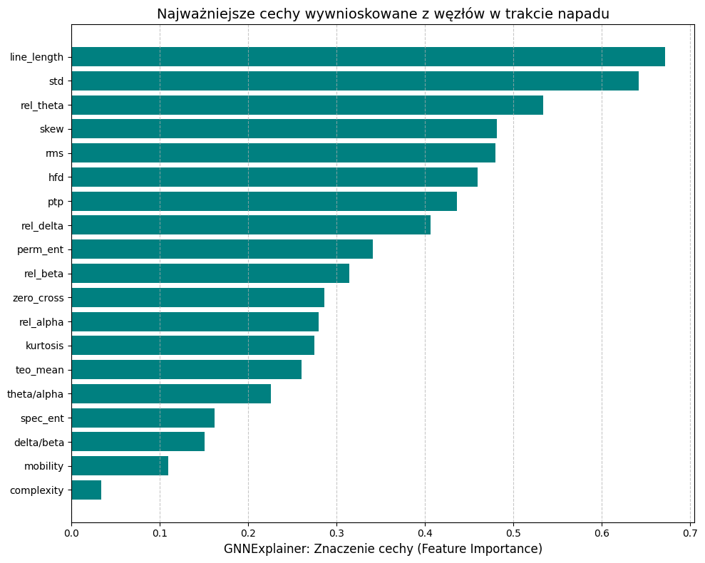
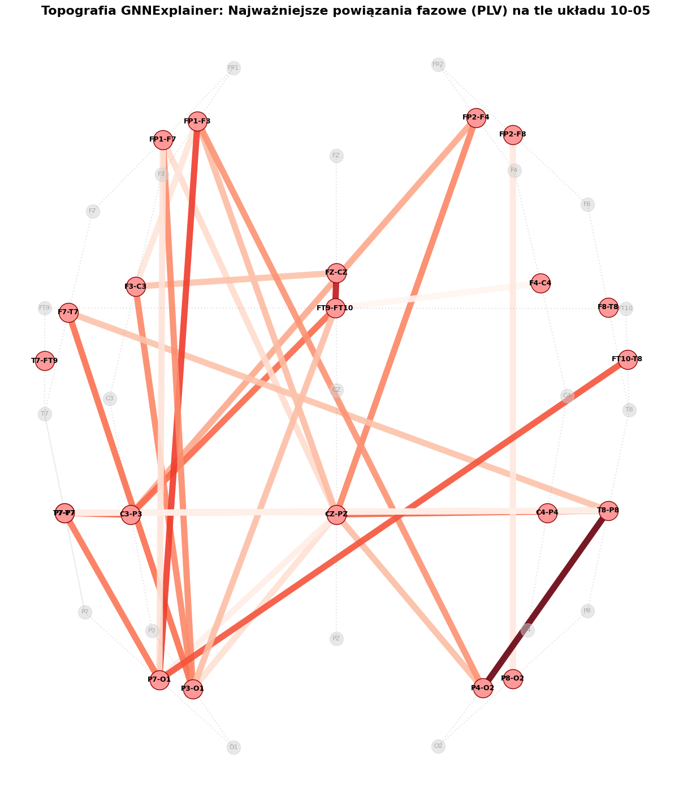
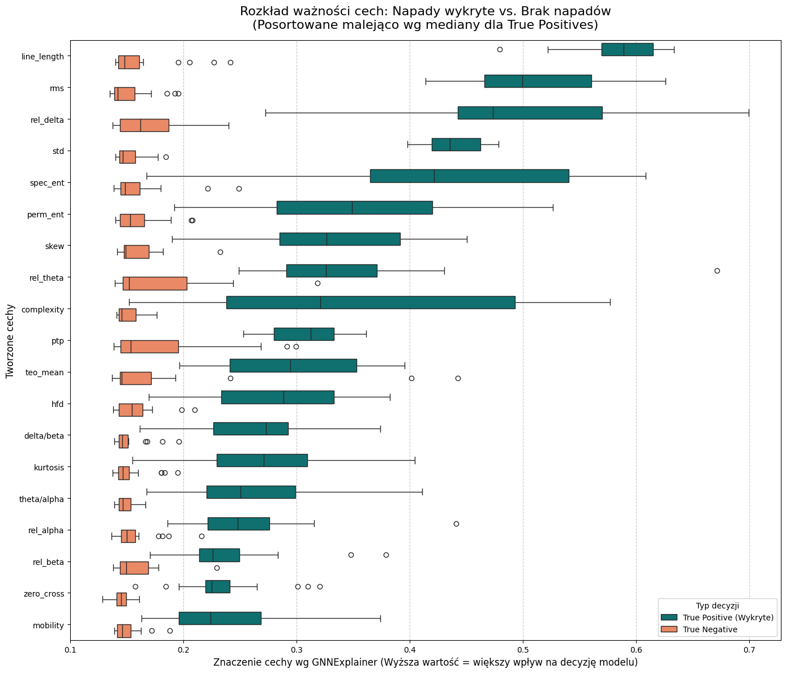
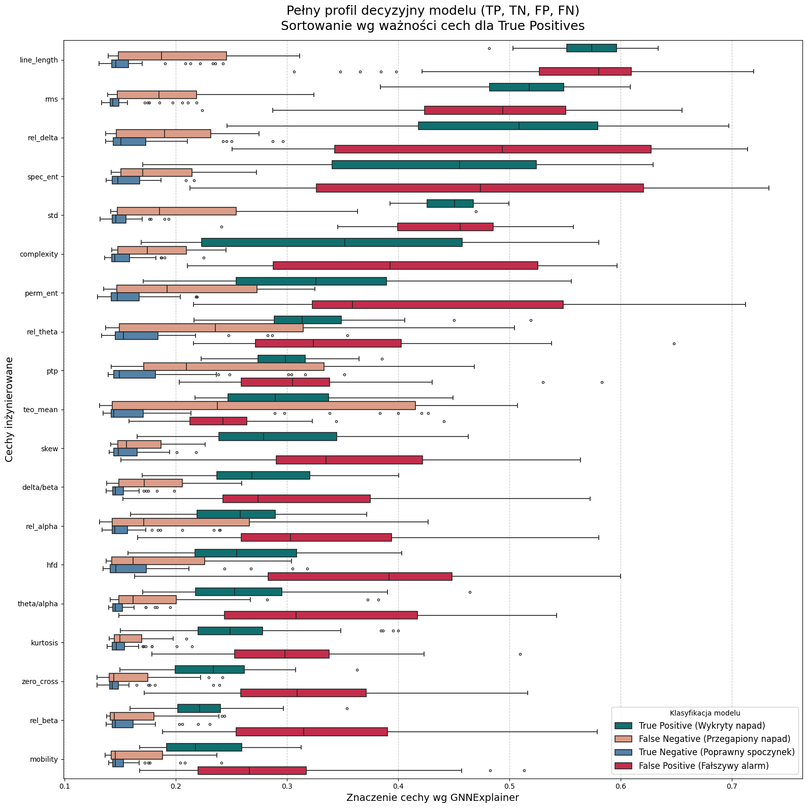

# Explainable Graph Neural Networks for Epileptic Seizure Detection via EEG Signals

This project investigates the explainability of a Graph Neural Network based on ChebConv for epileptic seizure detection using EEG signals and domain-specific handcrafted features. It uses **GNNExplainer** to analyze feature importance and graph connectivity at the individual-sample level, with additional comparisons across correctly classified seizure and non-seizure samples.

## Key Features and Methodology

- **Graph Construction:** EEG signals are represented as functional connectivity graphs using Phase Locking Value (PLV) between scalp EEG channels.
- **Handcrafted Features:** Domain-specific signal features, including Line Length, RMS, and the Teager Energy Operator, are computed over 6-second epochs and used as node features.
- **Model Architecture:** A Graph Neural Network based on ChebConv processes EEG connectivity graphs and their node features.
- **Explainability:** GNNExplainer is used to investigate feature importance and relevant graph connections for individual predictions.
- **Error Analysis:** Feature importance patterns are compared across correctly classified samples and examined in the context of false-positive and false-negative predictions.

## Dataset and Prerequisites

The experiments use the [CHB-MIT Scalp EEG Database](https://physionet.org/content/chbmit/1.0.0/), available through PhysioNet.

Download the dataset and place the extracted files in the project's `data/chb-mit/` directory. The expected structure is:

```text
eeg-gnn-xai/
├── data/
│   └── chb-mit/
│       ├── chb01/
│       ├── chb02/
│       ├── chb03/
│       └── ...
├── notebooks/
│   └── xai.ipynb
├── wyniki/
│   ├── feature_importance.png
│   ├── topography.png
│   ├── tp_vs_tn.png
│   └── confusion_all.png
├── requirements.txt
└── run_experiments.sh
```

The directory names above illustrate the expected layout. Keep the actual paths and filenames consistent with those used by the project scripts.

**Requirements:**
- Python 3.12.3 (recommended environment)
- Dependencies listed in `requirements.txt`
- Jupyter Notebook for the explainability analysis

## Quickstart

### 1. Set Up the Environment

Create and activate a virtual environment:

```bash
python -m venv venv
source venv/bin/activate
```

Install the required dependencies:

```bash
pip install -r requirements.txt
```

### 2. Run Data Preprocessing and Model Training

Execute the experiment script to run the data preprocessing pipeline and train the model:

```bash
bash run_experiments.sh
```

### 3. Explore the Explainability Analysis

Launch Jupyter Notebook:

```bash
jupyter notebook notebooks/xai.ipynb
```

The notebook contains the explainability analysis and the associated visualizations.

## Performance and Results

### Classification Metrics

The following metrics were obtained on the test set.

| Class | Precision | Recall | F1-Score | Support |
|:---|---:|---:|---:|---:|
| Non-Ictal | 0.94 | 0.99 | 0.97 | 6,846 |
| Ictal | 0.97 | 0.76 | 0.85 | 1,757 |
| **Accuracy** | | | **0.95** | **8,603** |
| Macro Average | 0.96 | 0.88 | 0.91 | 8,603 |
| Weighted Average | 0.95 | 0.95 | 0.94 | 8,603 |

**Detection AUROC (Non-Ictal vs. Ictal): 0.9483**

The model achieved high overall classification performance. However, the lower recall for ictal samples indicates that some seizure epochs were missed, making further investigation of false-negative predictions particularly important.

## Explainability and Model Analysis

### 1. Local Feature Importance

The following visualization illustrates the feature importance attributed to an individual seizure sample.



This explanation highlights the features identified as relevant to the model's prediction for the selected epoch. The results provide insight into which signal characteristics contributed to the classification, but do not independently establish a causal relationship between individual features and seizure activity.

### 2. Graph Connectivity and Edge Importance



This visualization presents the importance of connections between EEG channels for the selected sample. The observed pattern may suggest lateralized connectivity relevant to the model's prediction. However, the importance assigned to graph edges should not be interpreted as definitive evidence of the anatomical origin of a seizure.

### 3. Feature Importance Across True Positives and True Negatives



This comparison examines feature importance for correctly classified seizure samples (True Positives, TP) and non-seizure samples (True Negatives, TN).

Differences in feature importance can indicate which signal characteristics the model relies on in different classification contexts. Features related to signal complexity and amplitude variation, such as `line_length` and `rms`, may contribute differently to seizure and non-seizure predictions.


### 4. Confusion Category Analysis



This visualization compares feature importance across classification categories, including:

- **True Positives (TP):** Seizure samples correctly classified as ictal.
- **True Negatives (TN):** Non-seizure samples correctly classified as non-ictal.
- **False Positives (FP):** Non-seizure samples incorrectly classified as ictal.
- **False Negatives (FN):** Seizure samples incorrectly classified as non-ictal.

Comparing these categories can help identify differences in the features associated with correct and incorrect predictions.

False positives may be associated with signal patterns that resemble seizure activity, potentially including movement artifacts or eye blinks. False negatives may reveal cases in which the model fails to capture relevant seizure-related patterns or relies heavily on individual features, such as `teo_mean`.


## Limitations and Future Work

Several directions could improve the analysis:

- **Graph Structure Analysis:** Investigate whether important edges are consistent across seizure samples and whether they correspond to clinically meaningful connectivity patterns.
- **Electrode-Level Validation:** Compare explanations with datasets containing channel-level seizure annotations, such as the Temple University Hospital Seizure Detection Corpus (TUSZ), where suitable annotations are available.
- **Error Analysis:** Examine false-positive and false-negative predictions to identify recurring feature patterns and potential sources of error.
- **Explanation Robustness:** Test the stability of feature and edge importance under small input perturbations and model parameter changes.
- **Broader Evaluation:** Assess the consistency of explanations across patients, seizure events, and different experimental settings.

## References

1. [CHB-MIT Scalp EEG Database](https://physionet.org/content/chbmit/1.0.0/) — EEG dataset used in the experiments.
2. Defferrard, M., Bresson, X., & Vandergheynst, P. (2016). [Convolutional Neural Networks on Graphs with Fast Localized Spectral Filtering](https://doi.org/10.48550/arXiv.1606.09375). — Graph convolutional architecture underlying ChebConv.
3. Ying, R., Bourgeois, D., You, J., Zitnik, M., & Leskovec, J. (2019). [GNNExplainer: Generating Explanations for Graph Neural Networks](https://doi.org/10.48550/arXiv.1903.03894). — Graph neural network explanation method.
4. [Graph Neural Network-based EEG Classification: A Survey](https://doi.org/10.48550/arXiv.2310.02152) — Overview of graph neural networks for EEG classification.
5. [Explainable Graph Neural Networks for EEG Classification and Seizure Detection in Epileptic Patients](https://ieeexplore.ieee.org/document/10635821) — Related work on explainable graph neural networks for EEG analysis.

---

*This project was developed for academic purposes and is intended for research and educational use. The results should not be interpreted as clinical validation of an epileptic seizure detection system.*